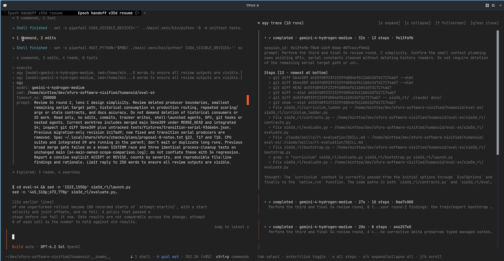

# opencode-agy-acp

Zero-dependency OpenCode 2.x plugin (`dayvidpham.opencode-agy-acp`) that drives the official Google Antigravity CLI (`agy acp`) over the Agent Client Protocol (ACP), bridges permission requests into OpenCode's native `ctx.permission.assert(...)` rules, and streams live step progress into the OpenCode TUI.

## Why ACP instead of `agy -p` or OAuth plugins?

- **No OAuth token spoofing:** Authentication stays inside the official `agy` CLI (`~/.gemini/antigravity-cli/`).
- **Native OpenCode permissions:** ACP `session/request_permission` requests from `agy` are mapped to OpenCode's `read` / `edit` / `bash` / `webfetch` / `agy` actions and evaluated through `ctx.permission.assert(...)`, using your existing `opencode.json` rules and interactive prompts.
- **Explicit sessions & concurrent runs:** Spawns an isolated `agy acp` subprocess per tool call so multiple `agy` agents can run concurrently (including in parallel inside OpenCode Code Mode `execute`). Omitting `session_id` always starts a fresh session; passing `session_id` explicitly continues that session via ACP `session/load` (failing loudly with `AGY_ERROR [SESSION_LOAD_FAILED]` if it cannot be loaded).
- **Live TUI step streaming:** Exports a `./tui` OpenCode 2.x TUI plugin that renders a zero-extra-height live indicator in `prompt.footer.status` (next to subagents/shells) and a scrollable, collapsible trace panel in `session.panel` (`/agy-trace`). Uses a lightweight atomic trace store (`/tmp/opencode-agy-acp-traces/<sessionID>.json`) so live steps stream identically for both direct `agy` tool calls and nested Code Mode (`execute`) calls.
- **Hot-reload & cancellation hygiene:** Forwards `AbortSignal` to ACP `session/cancel`, closes each subprocess in `finally`, and does not kill in-flight `agy` turns when the plugin hot-reloads.
- **Scrubbed environment:** Passes only an explicit allowlist (`PATH`, `HOME`, `XDG_*`, `AGY_*`, `NIX_*`, locale/proxy/TLS vars) to `agy acp` so unrelated provider API keys are never leaked.

## Installation

1. Ensure `agy` is installed and signed in (`agy` interactive login).
2. Clone this repo and add its path to `"plugins"` in `~/.config/opencode/opencode.json`:

```json
{
  "plugins": [
    "/path/to/opencode-agy-acp"
  ]
}
```

3. Restart OpenCode (and the background service if already running).

Optional environment variables:
- `AGY_BIN`: override the `agy` binary path (defaults to `agy` on `PATH`).

## Slash Commands & TUI Trace Panel



- **`/agy <task>`** — delegates a task to the `agy` tool with structured prompt guidance.
- **`/agy-trace`** (or `Ctrl+P` → **Toggle agy trace panel**) — opens or closes the scrollable `agy-trace` panel (`session.panel`) showing all running and completed `agy` runs in the current session. Running trajectories expand automatically; completed runs start collapsed and can be toggled individually or all at once.
- **Live footer indicator (`prompt.footer.status`)** — appears inline in the prompt footer while one or more `agy` agents are running (e.g. `◈ 3 agy (180 steps)`) without taking extra vertical space. Clicking it opens the full trace panel.

### Trace Panel Keyboard Shortcuts

When the `agy-trace` panel is focused (or in fullscreen):

| Key | Action |
| --- | --- |
| `Tab` / `Shift+Tab` | Select next / previous trajectory |
| `Enter` / `Space` (or click header) | Expand / collapse selected trajectory |
| `e` / `c` | Expand all / collapse all trajectories |
| `f` | Toggle fullscreen / split |
| `q` / `Esc` | Close panel |
| `j` / `↓`, `k` / `↑` | Scroll down / up |
| `PgDn` / `Ctrl+D`, `PgUp` / `Ctrl+U` | Page down / up |
| `g` / `Shift+G` | Jump to top / bottom |

## Tool Interface (`agy`)

| Parameter | Type | Description |
| --- | --- | --- |
| `prompt` | `string` (required) | Task or question to send to `agy`. Start with a normal word (never a leading `/`, which triggers `agy` slash-command expansion). |
| `session_id` | `string` | Explicitly continue a specific `agy` ACP session ID via `session/load`. Omit to always start a fresh `agy` session. |
| `cwd` | `string` | Working directory for the `agy` session (defaults to the current workspace). |
| `model` | `string` | Optional model ID to select via ACP `session/set_model` (e.g. `gemini-4-hydrogen-medium`, `gemini-4-neon-medium`, `gemini-4-argon-medium`, or `claude-sonnet-5-5-medium` / `claude-opus-5-5-medium`). |
| `timeout_ms` | `number` | Turn timeout in ms (default `900000` = 15 min; min `1000`, max `14400000`). |

Every response (success or error, once a session exists) appends `[agy_session_id: <id>]` to `content` and includes `metadata.agySessionId`, making explicit follow-ups and timeout recovery straightforward.

### Structured Errors (`AGY_ERROR [CODE]`)

`TIMEOUT`, `SESSION_LOAD_FAILED`, `AUTH_REQUIRED`, `QUOTA_EXHAUSTED`, `MODEL_NOT_FOUND`, `AGY_NOT_FOUND`, `INVALID_ARGUMENT`, `AGY_FAILED`.

## Project Layout

- `src/index.ts` — OpenCode server plugin (`agy` tool, `/agy` command, `opencode-agy-acp` skill registration)
- `src/tui.tsx` — OpenCode `./tui` plugin (`session.composer.top` live feed, `session.panel` trace viewer, `/agy-trace`)
- `src/acp.ts` — Zero-dependency bidirectional NDJSON JSON-RPC 2.0 ACP client + env scrubbing
- `src/permissions.ts` — ACP `session/request_permission` → OpenCode `ctx.permission.assert(...)` bridge
- `src/trace.ts` — Atomic per-session trace store shared between server and TUI
- `src/errors.ts` — Structured error classification and secret scrubbing
- `commands/agy.md` & `skills/opencode-agy-acp/SKILL.md` — Bundled `/agy` command prompt and usage skill
- `test/acp.test.ts` — Offline mock-ACP unit test suite

## Testing

```bash
bun test
```
